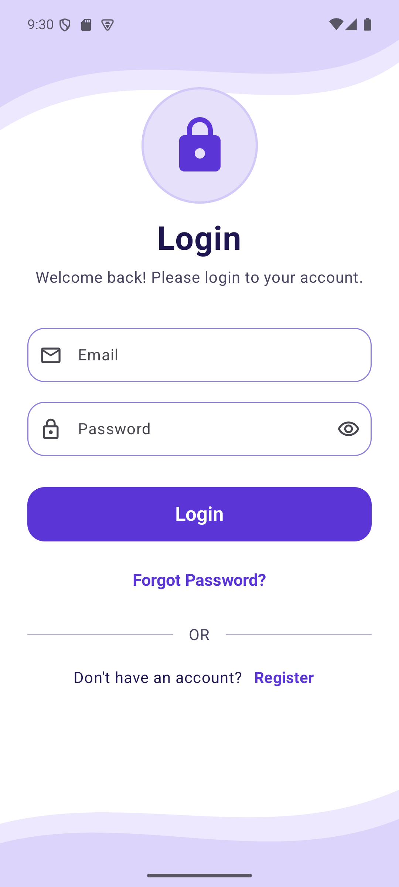
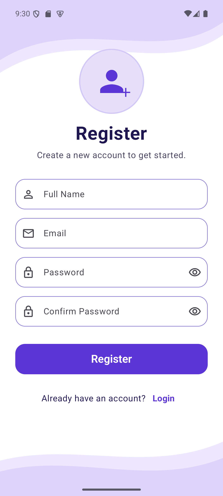

# Login & Register UI with Jetpack Compose

A simple Android app with a **Login** screen and a **Register** screen, built with
Jetpack Compose. It is a practice project for beginners: the screen Composables take
**no parameters**, all the UI for a screen lives in one function, and the code has
comments showing where each UI component starts and ends.

## Screenshots

| Login | Register |
|:-----:|:--------:|
|  |  |

## Features

**Login screen**
- Email and Password fields with icons
- Show / hide password with the eye button
- Login button with a simple empty-field check
- Forgot Password link
- "Don't have an account? Register" link

**Register screen**
- Full Name, Email, Password and Confirm Password fields
- Separate show / hide button for each password field
- Register button that checks all fields are filled and both passwords match
- "Already have an account? Login" link

## Built with

- Kotlin
- Jetpack Compose with Material 3
- Android Studio
- Min SDK 24

## Project files

| File | What it does |
|------|--------------|
| `MainActivity.kt` | Starts the app and shows Login or Register depending on `currentScreen` |
| `LoginScreen.kt` | The Login screen UI |
| `RegisterScreen.kt` | The Register screen UI |
| `ui/theme/Color.kt` | All colors used by the screens |
| `ui/theme/Theme.kt` | `AppTheme`, which applies the colors and fonts to the whole app |
| `res/drawable/` | Icons and the top/bottom wave images (vector drawables) |

## Compose concepts used

- **@Composable**: a function that describes UI. Compose calls it again when its data changes.
- **State with `remember` and `mutableStateOf`**: `var email by remember { mutableStateOf("") }`
  stores a value that can change. When it changes, the UI that reads it updates on its own
  (this is called *recomposition*).
- **Layouts**
  - `Column`: items one below another
  - `Row`: items side by side
  - `Box`: items on top of each other (used to put the waves behind the form)
  - `Spacer`: empty space between items
- **Modifier**: sets size, padding, background, border and more. Applied in order.
- **`RoundedCornerShape` and `border`**: `RoundedCornerShape(18.dp)` rounds the corners of the
  text fields and buttons. `Modifier.border(2.dp, color, CircleShape)` draws the ring around the top icon.
- **`OutlinedTextField`**: a Material text field with a border.
  - `value` / `onValueChange` connect it to state.
  - `placeholder` is the grey hint text.
  - `leadingIcon` is the icon on the left, `trailingIcon` is the icon on the right.
  - `shape` sets the corner shape.
- **`OutlinedTextFieldDefaults.colors()`**: changes the border and cursor colors. Each screen
  creates it once as `fieldColors` and uses it for all its fields.
- **Password visibility toggle**: an `IconButton` in `trailingIcon` flips `passwordVisible`.
  `visualTransformation` shows dots (`PasswordVisualTransformation()`) or plain text (`VisualTransformation.None`).
- **Button / TextButton / IconButton**: clickable buttons. Their `onClick` runs when tapped.
- **@Preview**: shows a Composable in Android Studio without running the app.

## How Login / Register navigation works

`currentScreen` in `MainActivity.kt` is a state value. The Register link sets it to
`"register"` and the Login link sets it back to `"login"`. Because it is state, Compose
redraws `setContent { }` and the other screen is shown. This is a simple approach for
learning; bigger apps usually use the Navigation Compose library.

## How to run

1. Clone the repository:
   ```bash
   git clone https://github.com/himanshujha21/JetpackComposeLearning.git
   ```
2. In Android Studio, choose **File → Open** and select the
   `LoginRegisterBasicTextFieldNoParams` folder (not the top-level folder).
3. Wait for Gradle sync to finish, then press **Run ▶** on an emulator or phone.
