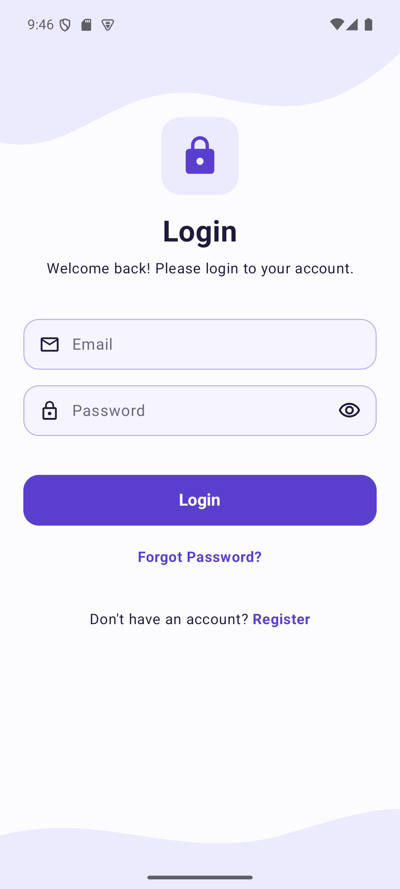
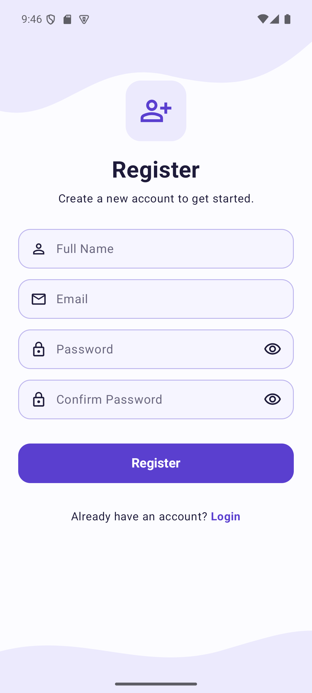

# Login & Register with BasicTextField

A simple Jetpack Compose app with Login, Register and Home screens.
The text fields are made with `BasicTextField` instead of Material's `TextField`,
so you can see how a custom input field is built.

## Screenshots

| Login | Register |
|:-----:|:--------:|
|  |  |

## Features

- Login, Register and Home screens
- Custom text fields built with `BasicTextField`, with icons and a purple border on focus
- Show / hide password button
- Checks for name, email and password, with error messages
- Purple wave background drawn with `Canvas`

## How to run

1. Clone the repository:
   ```bash
   git clone https://github.com/himanshujha21/JetpackComposeLearning.git
   ```
2. In Android Studio, choose **File → Open** and select the
   `LoginRegisterWithBasicTextField` folder (not the top-level folder).
3. Wait for Gradle sync to finish, then press **Run ▶** on an emulator or phone.

## Files

- `MainActivity.kt` - starts the app and switches between screens
- `ui/screens/` - `LoginScreen`, `RegisterScreen`, `HomeScreen`
- `ui/components/CustomTextField.kt` - `CustomTextField` and `PasswordTextField`
- `ui/components/CustomButtons.kt` - `PrimaryButton`, `LinkText`, `BottomTextLink`, `IconHeader`
- `ui/components/WaveBackground.kt` - the purple waves, drawn with `Canvas`
- `utils/Validation.kt` - checks for name, email and password
- `res/values/strings.xml` - all the text shown on screen

## How it works

**Switching screens.** `App()` in `MainActivity.kt` stores the current screen:

```kotlin
var currentScreen by rememberSaveable { mutableStateOf(Screen.Login) }
```

Setting `currentScreen = Screen.Home` makes Compose redraw and show the Home screen.

**State.** `mutableStateOf` holds a value Compose watches. When it changes, the UI updates.
`remember` keeps the value between redraws, and `rememberSaveable` also keeps it when
the phone rotates.

**State hoisting.** The text fields don't store their own text. The screen keeps it
and passes it in with `value`. When the user types, the field calls `onValueChange`
and the screen updates the variable.

**Callbacks.** A screen doesn't decide where to go next. `LoginScreen` calls
`onLoginSuccess(email)`, and `App()` decides to open the Home screen.

**BasicTextField.** It only draws the text. The background, border, icon and hint
are drawn inside `decorationBox`. Call `innerTextField()` once in there to show the
actual text.

**Focus.** `Modifier.onFocusChanged { isFocused = it.isFocused }` tells us when the
field is tapped, so we can make the border purple.

**Keyboard.** `KeyboardType.Email` and `KeyboardType.Password` show the right keyboard.
`ImeAction.Done` on the last field lets the user submit from the keyboard.
`PasswordVisualTransformation()` hides the password as dots.

**Layout.** `Column` stacks items vertically, `Row` horizontally and `Box` on top of
each other. `Spacer` adds space. `imePadding()` moves the content up when the keyboard
opens, and `verticalScroll` lets it scroll on small screens.

## Things to try

- Change a text in `strings.xml`.
- Change the colors in `ui/theme/Color.kt`.
- Add a phone number field using `CustomTextField` with `keyboardType = KeyboardType.Phone`.
- Add a rule in `Validation.kt`, like "password must contain a number".
