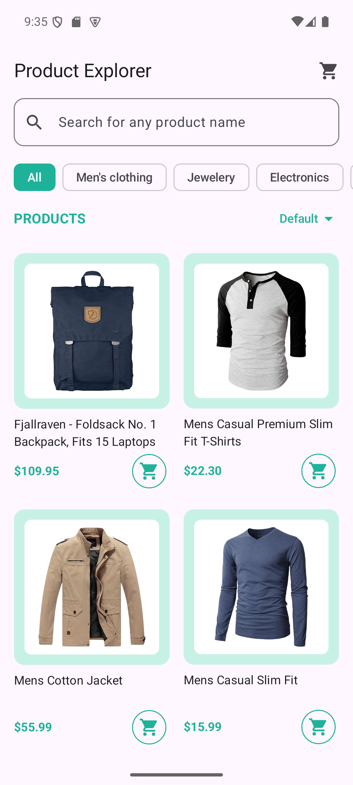
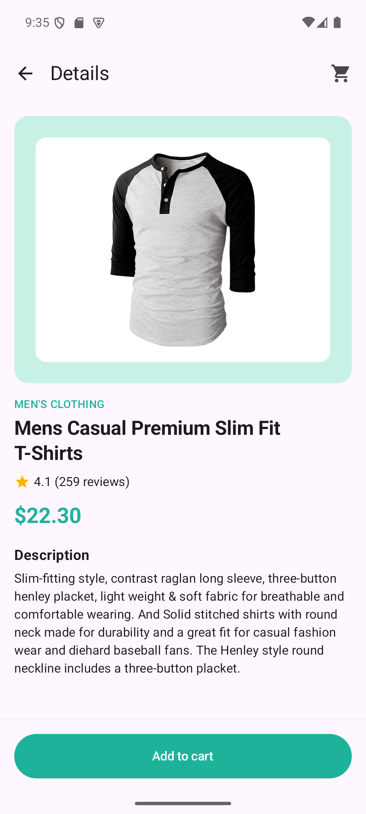

# Product Explorer App

A simple shopping app made with Jetpack Compose. It gets products from the free
[Fake Store API](https://fakestoreapi.com/), so you don't need an API key. You can
browse products, search, add things to the cart and try a demo checkout.

## Screenshots

### Products



### Search


### Product Detail



### Cart


### Checkout


## Features

- Browse products in a grid
- Search products by name
- Filter products by category
- Sort by price, rating or name
- See product details
- Add items to the cart and change the quantity
- Demo checkout (no real payment)
- Cart badge that shows the item count
- Loading, error and empty screens

## Tech Stack

- Kotlin
- Jetpack Compose with Material 3
- Navigation Compose
- Hilt
- Retrofit with `kotlinx.serialization`
- Coil
- ViewModel and StateFlow

## Project Structure

The code has three main layers, plus a `di` folder that connects them:

```
productexplorerapp/
├── data/            # where the data comes from
├── domain/          # what the app does
├── presentation/    # what the user sees
└── di/              # how everything is connected
```

## Clean Architecture

Clean Architecture means splitting the app into layers, where each layer has one job.
This app has three main layers: **data**, **domain** and **presentation**. Dependency
injection (the `di` folder) isn't a layer of its own logic. It just connects the three,
so it has its own section further down.
The main rule is simple: the inner layer (domain) doesn't know anything about the
outer layers. It has no Retrofit, no Compose and no Android code.

Here's how the layers depend on each other:

```
presentation  -->  domain  <--  data
                     ^
                     |
                    di (connects them all)
```

- `presentation` uses `domain` to get things done.
- `data` implements what `domain` asks for.
- `domain` depends on nothing.

Why bother?

- When the API changes, you only change the `data` folder.
- The business logic can be tested without a phone or the internet.
- Each file is small and does one thing, so it's easy to find your way around.

### Data Layer

The data layer gets the data. Right now it gets everything from the internet.

- `data/remote/ProductApi.kt`: the Retrofit interface with the API calls.
  This is the **remote data source**.
- `data/remote/ProductDto.kt`: classes that match the JSON from the API.
- `data/repository/ProductRepositoryImpl.kt`: calls the API and turns each
  `ProductDto` into a `Product`.
- `data/repository/CartRepositoryImpl.kt`: keeps the cart in memory.

There's no local database in this project yet. If you want to keep the cart
after the app closes, add Room (or DataStore) here. Something like a
`data/local/CartDao.kt` would be the **local data source**, and `CartRepositoryImpl`
would read and write through it. No other layer would need to change.

### Domain Layer

The domain layer is the core of the app. It's plain Kotlin.

- `domain/model/`: `Product`, `CartItem` and `SortOption`.
- `domain/repository/`: the `ProductRepository` and `CartRepository` interfaces.
- `domain/usecase/`: `GetProductsUseCase`, `GetProductDetailsUseCase` and
  `FilterProductsUseCase`.

This layer says *what* the app needs (for example "give me all products"),
but not *how* it's done.

### Presentation Layer

The presentation layer is everything the user sees and touches.

- `productlist/`, `productdetail/`, `cart/`: each screen with its ViewModel and UI state.
- `components/`: small reusable Composables like `ProductCard`, `ProductSearchBar`,
  `CategoryChips` and `SortMenu`.
- `navigation/`: the routes and `AppNavigation`, which moves between screens.
- `theme/`: colors and the Material theme.

The flow inside this layer:

- The screen shows what's in the UI state.
- When the user taps something, the screen calls a ViewModel function.
- The ViewModel calls a use case or repository and updates the UI state.
- The screen redraws by itself.

## Use Cases

### What is a use case?

A use case is a small class that does one thing the user wants to do.
In this app:

- `GetProductsUseCase` gets all products.
- `GetProductDetailsUseCase` gets one product by its id.
- `FilterProductsUseCase` searches, filters and sorts a list of products.

### Why use them?

- The ViewModel stays small. It just calls the use case instead of doing the work itself.
- The logic is in one place. If two screens need the same thing, they share the use case.
- They're easy to test. `FilterProductsUseCase` is plain Kotlin, so the test just passes
  in a list and checks the result (see `FilterProductsUseCaseTest`).

`GetProductsUseCase` only calls the repository, and that's fine. If you later
need a rule like "hide products that have no picture", you add it to the use case
and the ViewModel doesn't change.

### How does it work?

Here's what happens when the product list opens:

1. `ProductListViewModel` calls `getProductsUseCase.getProducts()`.
2. The use case calls `productRepository.getProducts()`.
3. Hilt has given it a `ProductRepositoryImpl`, which calls `productApi.getProducts()`.
4. Retrofit downloads the JSON and turns it into a list of `ProductDto`.
5. The repository turns each `ProductDto` into a `Product` and returns the list.
6. The ViewModel puts the products in its UI state, and the screen shows them.

```
ProductListScreen -> ProductListViewModel -> GetProductsUseCase
    -> ProductRepository -> ProductRepositoryImpl -> ProductApi -> internet
```

The search works in a similar way, but without the internet. When you type,
the ViewModel calls `filterProductsUseCase.filterProducts(...)` with the products
it already has, and shows the new list.

## Other Parts of Clean Architecture

### Models

Models are simple data classes that hold data.

- **Domain models** (`Product`, `CartItem`) are what the app uses everywhere.
- **DTOs** (`ProductDto`, `RatingDto`) match the API's JSON exactly.

They're kept apart on purpose. The API sends a nested `rating` object and calls
the picture `image`. The app's `Product` has flat `rating` and `ratingCount`
fields and calls the picture `imageUrl`. The repository converts one into the
other, so if the API changes, only the DTO and the mapper need to change.

### Interfaces

An interface lists functions without writing their code.

```kotlin
interface ProductRepository {
    suspend fun getProducts(): List<Product>
    suspend fun getProductById(id: Int): Product
}
```

The ViewModels and use cases only know this interface. They don't know if the
products come from the internet, a database or a fake list in a test.
That's what lets you swap the real code for something else without breaking anything.

### Repositories

A repository is the one place the rest of the app goes to for data.

- The **interface** lives in `domain` (`ProductRepository`).
- The **implementation** lives in `data` (`ProductRepositoryImpl`).

The repository decides where the data comes from. Today `ProductRepositoryImpl`
always calls the API. Later it could check a local database first and only
call the API when it has nothing saved. The use cases wouldn't notice the change.

### Data Sources

A data source is the thing that actually gets the data.

- **Remote data source**: something on the internet. Here it's `ProductApi` (Retrofit).
- **Local data source**: something on the phone, like a Room database or DataStore.
  This project doesn't have one yet.

The repository uses the data sources. The rest of the app never talks to them directly.

### ViewModels

A ViewModel holds the data for one screen and handles what the user does on it.

- It keeps the screen's data in a `StateFlow` (for example `ProductListUiState`).
- The screen reads that state with `collectAsStateWithLifecycle()` and redraws when it changes.
- It survives screen rotation, so the products aren't downloaded again.
- It calls use cases and repositories. The Composable never does.

Example from `ProductListViewModel`:

```kotlin
fun onSearchTextChange(text: String) {
    _uiState.value = _uiState.value.copy(searchText = text)
    updateVisibleProducts() // calls FilterProductsUseCase
}
```

The screen just hands `viewModel.onSearchTextChange(text)` to the search bar.
Neither of them knows how the search works.

## DI Layer (Hilt)

### What is dependency injection?

A class often needs other classes to work. For example, `ProductListViewModel`
needs `GetProductsUseCase`, which needs a `ProductRepository`, which needs a `ProductApi`,
which needs Retrofit.

Without DI, you'd build that whole chain by hand:

```kotlin
val json = Json { ignoreUnknownKeys = true }
val retrofit = Retrofit.Builder()
    .baseUrl("https://fakestoreapi.com/")
    .addConverterFactory(json.asConverterFactory("application/json".toMediaType()))
    .build()
val api = retrofit.create(ProductApi::class.java)
val repository = ProductRepositoryImpl(api)
val useCase = GetProductsUseCase(repository)
```

With Hilt, each class just asks for what it needs in its constructor,
and Hilt builds and passes it in:

```kotlin
class GetProductsUseCase @Inject constructor(
    private val productRepository: ProductRepository,
)
```

### Files in the DI layer

- `ProductExplorerApplication.kt`: has `@HiltAndroidApp`, which starts Hilt.
- `di/NetworkModule.kt`: tells Hilt how to build Retrofit and `ProductApi`.
- `di/RepositoryModule.kt`: tells Hilt which real class goes with each interface.

### How Hilt modules provide dependencies

Hilt can build your own classes on its own if they have `@Inject constructor`.
It needs help in two cases, and that's what modules are for.

**1. Classes you didn't write, like Retrofit.** You can't add `@Inject` to them,
so you write a `@Provides` function that builds the object:

```kotlin
@Module
@InstallIn(SingletonComponent::class)
object NetworkModule {

    @Provides
    @Singleton
    fun provideRetrofit(): Retrofit {
        val json = Json { ignoreUnknownKeys = true }

        return Retrofit.Builder()
            .baseUrl("https://fakestoreapi.com/")
            .addConverterFactory(json.asConverterFactory("application/json".toMediaType()))
            .build()
    }

    @Provides
    @Singleton
    fun provideProductApi(retrofit: Retrofit): ProductApi {
        return retrofit.create(ProductApi::class.java)
    }
}
```

`provideProductApi` needs a `Retrofit`, so Hilt calls `provideRetrofit()` first
and passes the result in.

**2. Interfaces.** Hilt can't build an interface, so you tell it which class to use
with `@Binds`:

```kotlin
@Module
@InstallIn(SingletonComponent::class)
abstract class RepositoryModule {

    @Binds
    @Singleton
    abstract fun bindProductRepository(impl: ProductRepositoryImpl): ProductRepository
}
```

This reads as: "when someone asks for a `ProductRepository`, give them a `ProductRepositoryImpl`."

### Other Hilt annotations used here

- `@InstallIn(SingletonComponent::class)`: the objects from this module live as long as the app.
- `@Singleton`: only one object is made for the whole app. That's why every screen sees the same cart.
- `@AndroidEntryPoint` on `MainActivity`: lets the screens inside it get ViewModels from Hilt.
- `@HiltViewModel` on a ViewModel and `hiltViewModel()` in the screen: Hilt creates the
  ViewModel and passes in its use cases and repositories.

## How It All Works Together

Here's the full path when you tap the cart button on a product card:

1. `ProductCard` calls its `onAddToCartClick` lambda.
2. `ProductListScreen` passes that click to `viewModel.addToCart(product)`.
3. `ProductListViewModel` calls `cartRepository.addToCart(product)`.
4. Hilt gave the ViewModel the single `CartRepositoryImpl`, which adds the item
   to its `StateFlow`.
5. Every screen that collects `cartItems` sees the new list, so the cart badge
   updates everywhere.

Each piece only knows the piece right next to it. The card doesn't know about
the ViewModel, and the ViewModel doesn't know how the cart is stored.

## Good to Know

- The product list is loaded once when the app opens.
- Search, filter and sort work on that list, so no extra API calls are made.
- The cart is shared by all screens because the cart repository is a singleton.
- The detail screen gets the product id from the navigation route.

## API

- `GET https://fakestoreapi.com/products` returns all products.
- `GET https://fakestoreapi.com/products/{id}` returns one product.

## How to Run

1. Open the `ProductExplorerApp` folder in Android Studio.
2. Wait for Gradle sync to finish.
3. Run the app on an emulator or a phone with internet access.

To run the tests, right-click `FilterProductsUseCaseTest` and click **Run**, or use this command:

```
./gradlew test
```
