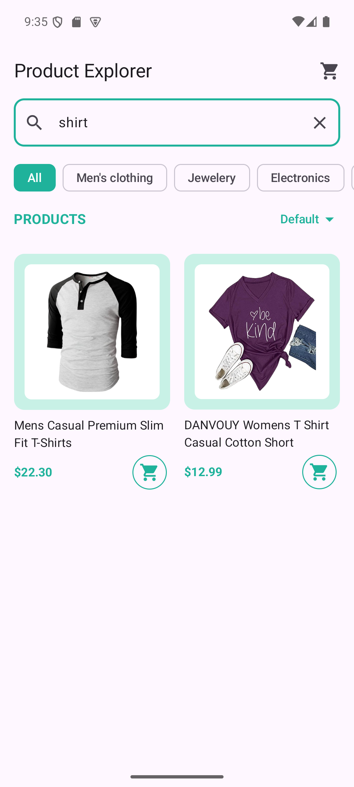
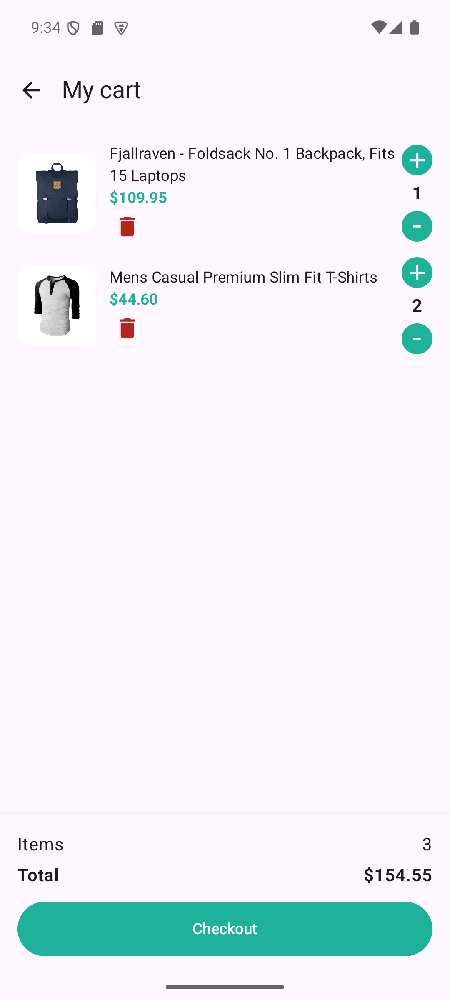
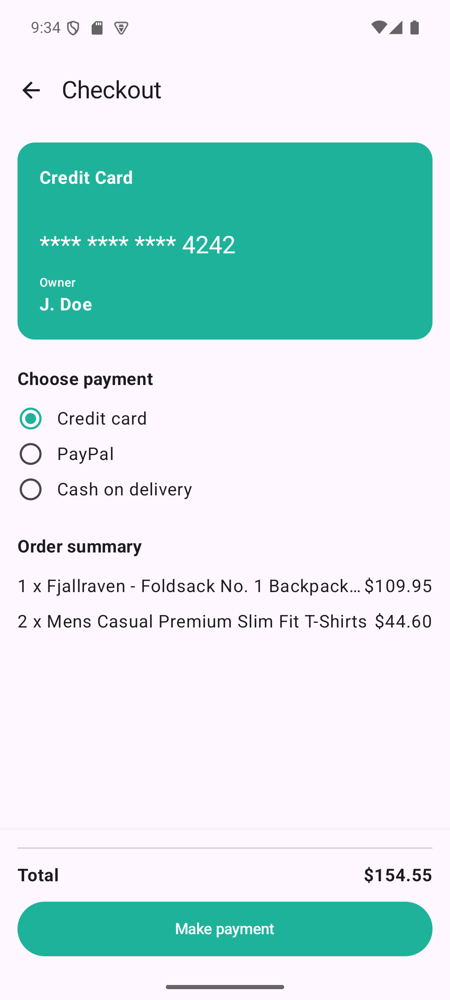

# Product Explorer App

A small shop app built with Jetpack Compose and **Clean Architecture**. It loads products from
the free [Fake Store API](https://fakestoreapi.com/) (no API key needed). You can search, filter
by category, sort, open a product, add it to the cart and go through a demo checkout.

The design is based on the teal and mint "Shopwise" e-commerce UI.

## Screenshots

| Products | Search | Detail | Cart | Checkout |
|:--------:|:------:|:------:|:----:|:--------:|
|  |  |  |  |  |

## Features

- Product grid with image, name, price and an add-to-cart button
- Search by product name while you type
- Category chips (All, Men's clothing, Jewelery, Electronics, Women's clothing)
- Sorting: default, price low to high, price high to low, top rated, name A to Z
- Product detail screen (loaded by id with `GET /products/{id}`)
- Cart with + / − buttons, delete button, item count and total
- Checkout with payment method choice and an "Order placed" dialog (demo, no real payment)
- Cart badge in the top bar
- Loading, error (with Retry) and "no products found" states

## What you will learn

- **Clean Architecture**: the code is split into `data`, `domain` and `presentation` layers
- **Hilt**: dependency injection with `@HiltAndroidApp`, `@AndroidEntryPoint`, `@HiltViewModel`, `@Inject`, `@Module`, `@Provides` and `@Binds`
- **Use cases**: `GetProductsUseCase`, `GetProductDetailsUseCase`, `FilterProductsUseCase`
- **Repository pattern**: an interface in `domain`, the real class in `data`
- **DTO vs model**: the JSON class (`ProductDto`) is turned into the app's own class (`Product`) by `mapToProduct()`
- **Retrofit + kotlinx.serialization**: calling a REST API and reading JSON
- **ViewModel + StateFlow**: one `UiState` data class per screen, read with `collectAsStateWithLifecycle()`
- **Navigation Compose**: type-safe routes with `@Serializable`, arguments read with `SavedStateHandle.toRoute()`
- **Coil**: loading images from a URL with `AsyncImage`
- **Material 3**: `Scaffold`, `TopAppBar`, `FilterChip`, `DropdownMenu`, `BadgedBox`, `Snackbar`, `AlertDialog`, `RadioButton`
- **State hoisting**: components get their values and send changes back with lambdas
- **Unit testing**: `FilterProductsUseCaseTest` tests search, filter and sort without a phone

## Clean Architecture in short

Clean Architecture splits the app into **layers**. Each layer has one job, and the arrows only
point **inwards**: the UI knows about the domain, the data layer knows about the domain, but the
**domain knows about nobody**. It is plain Kotlin.

```
┌──────────────────────────────┐
│  presentation                │  Screens (Composables) + ViewModels
│  "what the user sees"        │
└──────────────┬───────────────┘
               │ calls use cases
               ▼
┌──────────────────────────────┐
│  domain                      │  Models, repository INTERFACES, use cases
│  "what the app does"         │  (plain Kotlin, no Android, no Retrofit)
└──────────────▲───────────────┘
               │ implements the interfaces
┌──────────────┴───────────────┐
│  data                        │  Retrofit API, DTOs,        
│  "where the data comes from" │  repository IMPLEMENTATIONS
└──────────────────────────────┘
```

**Why bother?**

- If you switch from Retrofit to something else, only the `data` layer changes.
- Business rules (search, filter, sort) are in one place and easy to test.
- Each file is small and does one thing, so it is easy to find your way around.

**Who connects the layers?** Hilt. The ViewModel asks for a `ProductRepository` (an interface).
`RepositoryModule` tells Hilt "give them a `ProductRepositoryImpl`". The ViewModel never knows
which class it really got.

## Project structure

```
com.example.productexplorerapp
├── ProductExplorerApplication.kt   @HiltAndroidApp, starts Hilt
├── MainActivity.kt                 @AndroidEntryPoint, sets theme + navigation
│
├── data/                           ── DATA LAYER ──
│   ├── remote/
│   │   ├── ProductApi.kt           Retrofit endpoints (GET /products, GET /products/{id})
│   │   └── ProductDto.kt           Classes that match the JSON exactly
│   └── repository/
│       ├── ProductRepositoryImpl.kt  Gets products from the API, turns ProductDto into Product
│       └── CartRepositoryImpl.kt     Keeps the cart in memory (@Singleton)
│
├── domain/                         ── DOMAIN LAYER (plain Kotlin) ──
│   ├── model/
│   │   ├── Product.kt
│   │   ├── CartItem.kt
│   │   └── SortOption.kt
│   ├── repository/
│   │   ├── ProductRepository.kt    Interface
│   │   └── CartRepository.kt       Interface
│   └── usecase/
│       ├── GetProductsUseCase.kt
│       ├── GetProductDetailsUseCase.kt
│       └── FilterProductsUseCase.kt  Search + category + sort
│
├── di/                             ── HILT MODULES ──
│   ├── NetworkModule.kt            Creates Retrofit and ProductApi
│   └── RepositoryModule.kt         Interface -> real class
│
└── presentation/                   ── PRESENTATION LAYER ──
    ├── navigation/
    │   ├── Routes.kt               @Serializable routes
    │   └── AppNavigation.kt        NavHost with all screens
    ├── productlist/                Screen + ViewModel + UiState
    ├── productdetail/              Screen + ViewModel + UiState
    ├── cart/                       CartScreen, CheckoutScreen, CartViewModel
    ├── components/                 ProductCard, ProductSearchBar, CategoryChips,
    │                               SortMenu, CartIconButton, StatusViews
    ├── theme/                      Teal / mint colors
    └── util/PriceFormatter.kt      109.95 -> "$109.95"
```

## How it works

### 1. Loading the products (following one call through all layers)

```
ProductListScreen
   │  hiltViewModel() gives us the ViewModel
   ▼
ProductListViewModel.init { loadProducts() }
   │  getProductsUseCase.getProducts()
   ▼
GetProductsUseCase
   │  productRepository.getProducts()        <- only knows the interface
   ▼
ProductRepositoryImpl                        <- Hilt passed in the real class
   │  productApi.getProducts()               <- Retrofit does GET /products
   │  .map { mapToProduct(it) }              <- ProductDto -> Product
   ▼
back up to the ViewModel, which updates _uiState
   ▼
the screen redraws with the products
```

The API is called in the ViewModel's `init`, not inside a Composable. A Composable can run many
times (every recomposition), but `init` runs only once, and the ViewModel survives screen rotation.

### 2. Search, category filter and sorting

All products are downloaded once and kept in the ViewModel (`allProducts`). Every time the search
text, the category chip or the sort option changes, the ViewModel calls `FilterProductsUseCase`
with the new values and puts the result in `uiState.products`. No new network call is needed.

### 3. Opening a product (navigation with an argument)

Tapping a card calls `navController.navigate(ProductDetailRoute(productId))`.
`ProductDetailViewModel` gets a `SavedStateHandle` from Hilt and reads the id back:

```kotlin
private val productId: Int = savedStateHandle.toRoute<ProductDetailRoute>().productId
```

So the screen itself doesn't need to pass the id to the ViewModel.

### 4. One cart for every screen

Each screen gets its **own** ViewModel from `hiltViewModel()`. The cart is still the same everywhere,
because every ViewModel receives the same `CartRepositoryImpl`, which is marked `@Singleton`.
`cartItems` is a `StateFlow`, so when you add an item on one screen, the badge on the others
updates by itself.

### 5. UI state

Each screen has one data class with everything it needs, for example:

```kotlin
data class ProductListUiState(
    val isLoading: Boolean = true,
    val errorMessage: String? = null,
    val products: List<Product> = emptyList(),
    val categories: List<String> = emptyList(),
    val searchText: String = "",
    val selectedCategory: String? = null,
    val sortOption: SortOption = SortOption.DEFAULT,
)
```

The screen picks what to show with a simple `when`: loading spinner, error with Retry,
"No products found", or the grid.

### 6. Side effects (Snackbar)

`showSnackbar()` is a suspend function, so it needs a coroutine. Inside a click we can't use
`LaunchedEffect`, so we use `rememberCoroutineScope()`:

```kotlin
val scope = rememberCoroutineScope()
...
onAddToCartClick = { product ->
    viewModel.addToCart(product)
    scope.launch { snackbarHostState.showSnackbar("Added to cart") }
}
```

## Hilt in 5 steps

1. **Start Hilt**: `@HiltAndroidApp` on `ProductExplorerApplication` (and register it in `AndroidManifest.xml`).
2. **Allow injection in the Activity**: `@AndroidEntryPoint` on `MainActivity`.
3. **Classes you own**: add `@Inject constructor(...)`. Hilt sees what they need and creates them
   (use cases, `ProductRepositoryImpl`, `CartRepositoryImpl`).
4. **Classes you don't own or interfaces**: write a module.
   - `@Provides` builds an object (Retrofit, `ProductApi`).
   - `@Binds` says which class to use for an interface (`ProductRepository` -> `ProductRepositoryImpl`).
5. **ViewModels**: `@HiltViewModel` + `@Inject constructor`, and in the screen use `hiltViewModel()`.

## The API

| What | Request |
|------|---------|
| All products | `GET https://fakestoreapi.com/products` |
| One product | `GET https://fakestoreapi.com/products/{id}` |

One product looks like this:

```json
{
  "id": 1,
  "title": "Fjallraven - Foldsack No. 1 Backpack, Fits 15 Laptops",
  "price": 109.95,
  "description": "Your perfect pack for everyday use...",
  "category": "men's clothing",
  "image": "https://fakestoreapi.com/img/81fPKd-2AYL._AC_SL1500_.jpg",
  "rating": { "rate": 3.9, "count": 120 }
}
```

The categories for the chips come from the products themselves (`map { it.category }.distinct()`),
so only one network call is needed for the list screen.

## How to read the code

### The comments

Every Composable starts and ends with a banner, and each part of the UI inside it has a short
section comment:

```kotlin
// ============================================================
// START: ProductCard
// One product in the grid: image, name, price and a cart button.
// ============================================================
@Composable
fun ProductCard(...) {
    Column {
        // ---------- Product image ----------
        AsyncImage(...)

        // ---------- Product name ----------
        Text(...)

        // ---------- Price + add to cart button ----------
        Row { ... }
    }
}
// ============================================================
// END: ProductCard
// ============================================================
```

- `// START:` / `// END:` = where a Composable begins and ends.
- `// ---------- Name ----------` = one piece of the UI inside it.
- Parts of a screen that have their own job are split into small Composables (`ProductGrid`,
  `ProductDetailContent`, `CartItemRow`, `CartSummary`, `PaymentBar`...), each with its own START/END.
- Screens get the ViewModel, but the smaller Composables only get data and lambdas. That makes
  them easy to reuse and to show in `@Preview`.

### How the screens are built

Bigger Composables are made by putting smaller ones inside each other:

```
ProductListScreen                     <- a whole screen
 └── Scaffold
      ├── TopAppBar
      │    └── CartIconButton         <- our own small component
      └── Column
           ├── ProductSearchBar
           ├── CategoryChips
           │    └── CategoryChip
           ├── Row ("PRODUCTS" + SortMenu)
           └── ProductGrid            (or LoadingView / ErrorView / MessageView)
                └── ProductCard

ProductDetailScreen
 └── Scaffold
      ├── TopAppBar (back + CartIconButton)
      ├── ProductDetailContent
      └── AddToCartBar                <- bottomBar

CartScreen
 └── Scaffold
      ├── LazyColumn
      │    └── CartItemRow
      └── CartSummary                 <- bottomBar

CheckoutScreen
 └── Scaffold
      ├── SavedCard
      ├── PaymentMethodRow (x3)
      ├── order summary rows
      ├── PaymentBar                  <- bottomBar
      └── AlertDialog ("Order placed")
```

### Compose basics used in this project

| Concept | What it means | Where to look |
|---------|---------------|---------------|
| `@Composable` | A function that draws part of the screen | every file in `presentation/` |
| `Column` / `Row` / `Box` | Put children under each other / next to each other / on top of each other | `ProductCard`, `CartItemRow` |
| `Modifier` | Changes size, padding, background, clicks... Order matters: `padding` then `background` is different from `background` then `padding` | `ProductCard` |
| `Scaffold` | Ready-made screen layout with top bar, bottom bar and snackbar slots | all screens |
| `LazyVerticalGrid` / `LazyColumn` / `LazyRow` | Scrolling lists that only create the items you can see | `ProductGrid`, `CartScreen`, `CategoryChips` |
| `remember { mutableStateOf() }` | Keeps a value while the Composable redraws, and redraws when it changes | `SortMenu` (is the menu open?) |
| `rememberSaveable` | Like `remember`, but also survives screen rotation | `CheckoutScreen` |
| Recomposition | Compose runs a Composable again when the state it reads changes | `collectAsStateWithLifecycle()` in the screens |
| State hoisting | A component gets its value from outside and reports changes with a lambda | `ProductSearchBar` |
| `@Preview` | Shows a Composable in Android Studio without running the app | the `...Preview` functions |

## Libraries

| Library | Used for |
|---------|----------|
| Jetpack Compose + Material 3 | UI |
| Navigation Compose | Moving between screens |
| Hilt (+ KSP) | Dependency injection |
| hilt-lifecycle-viewmodel-compose | `hiltViewModel()` |
| Retrofit + kotlinx.serialization | Network calls and JSON |
| Coil 3 | Loading images |
| lifecycle-runtime-compose | `collectAsStateWithLifecycle()` |

## How to run

1. Open the `ProductExplorerApp` folder in Android Studio.
2. Wait for Gradle sync.
3. Run on an emulator or phone with internet.
4. To run the unit tests: right-click `FilterProductsUseCaseTest` → **Run**.
