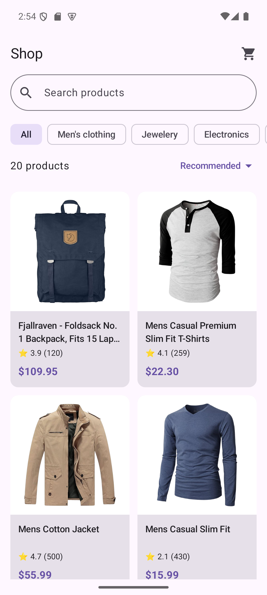
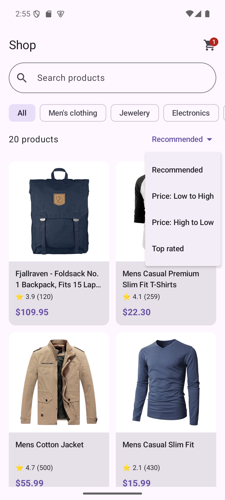
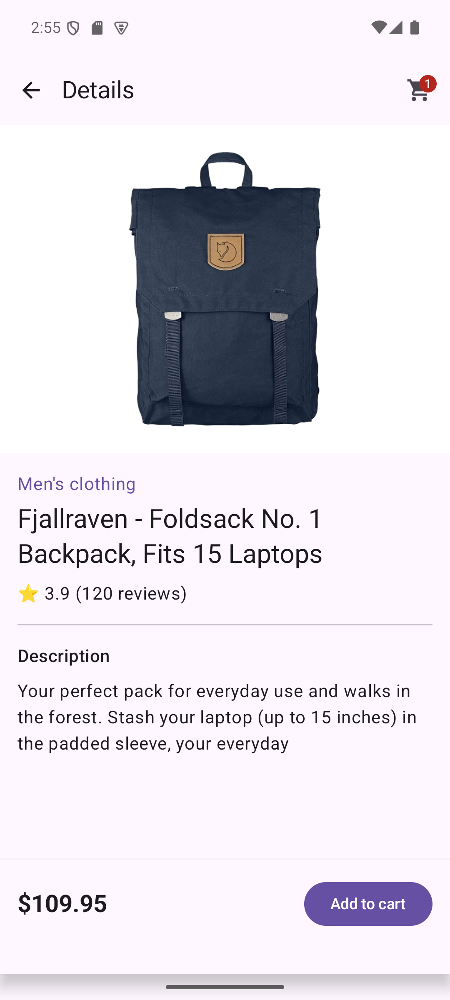
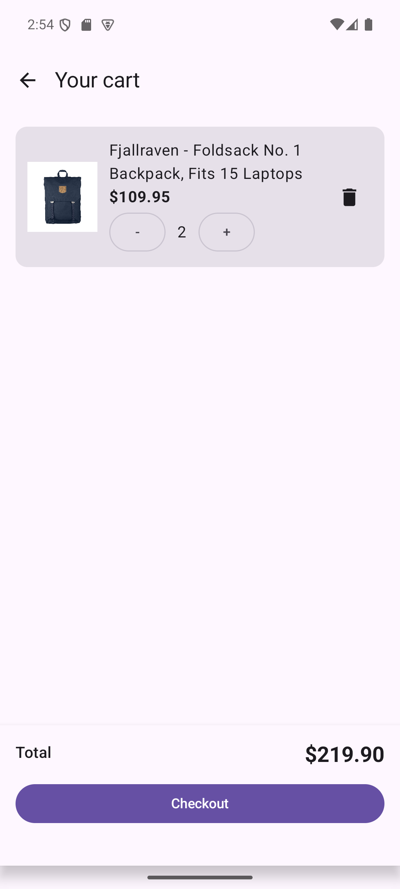

# Product Listing App

A small shop app built with Jetpack Compose. It loads products from the free
[Fake Store API](https://fakestoreapi.com/) (no API key needed), shows them in a grid,
opens a detail screen for each product, and lets you add items to a cart.

## Screenshots

| Products | Sort | Detail | Cart |
|:--------:|:----:|:------:|:----:|
|  |  |  |  |

## Features

- Product grid with photo, name, rating and price
- Search products by name while you type
- Filter by category (All, Men's clothing, Jewelery, Electronics, Women's clothing)
- Sort by price (low to high, high to low) or by rating
- Product detail screen, opened with the product id as a navigation argument
- Add to cart, with an "Added to cart" Snackbar
- Cart badge in the top bar that updates on every screen
- Cart screen: change quantity, remove items, see the total, checkout (shows an "Order placed" Snackbar)
- Loading, error (with Retry) and empty messages

## What you will learn

- **LazyVerticalGrid** - a grid that only creates the items on screen (`ProductListScreen.kt`)
- **Navigation Compose** - `NavHost`, `composable<Route>`, `navigate()` and `popBackStack()` (see [Navigation in Jetpack Compose](#navigation-in-jetpack-compose))
- **Navigation with arguments** - type-safe routes with `@Serializable`; `ProductDetailRoute(productId)` is read back with `toRoute()` (`navigation/Routes.kt`)
- **Side effects** - `LaunchedEffect` and `rememberCoroutineScope` for showing Snackbars (see [Side Effects in Jetpack Compose](#side-effects-in-jetpack-compose))
- **Shared state across screens** - one `CartViewModel` is created above the `NavHost` and passed to every screen
- **Retrofit + kotlinx.serialization** - calling a REST API and turning JSON into Kotlin classes
- **ViewModel + StateFlow** - `MutableStateFlow`, `copy()` and `collectAsStateWithLifecycle()`
- **Coil** - loading images from a URL with `AsyncImage`
- **Reusable components** - `ProductCard`, `CartIconButton`, `ProductSearchBar`, `CategoryFilterRow`, `SortMenu`
- **State hoisting** - components get their value and send changes back with lambdas (e.g. `ProductSearchBar`)
- **Material 3** - `Scaffold`, `TopAppBar`, `FilterChip`, `DropdownMenu`, `BadgedBox`, `Snackbar`

## How to read the code

### What is a Composable?

In Jetpack Compose the UI is built from **Composable functions**: normal Kotlin functions
marked with `@Composable`. Each one draws a piece of the screen, and bigger Composables are
made by putting smaller ones inside each other:

```
ProductListScreen                 <- a whole screen
 └── Scaffold
      ├── TopAppBar
      │    └── CartIconButton           <- our own small component
      └── ProductListContent
           ├── ProductSearchBar
           ├── CategoryFilterRow
           ├── SortMenu
           └── ProductGrid
                └── LazyVerticalGrid
                     └── ProductCard    <- one product in the grid
```

When the state changes (for example, the cart count), Compose calls the function again
and the screen updates by itself. This is called **recomposition**.

### START / END comments

Because Composables sit inside each other, it can be hard to see where one ends and the
next one starts. So every Composable in this project is wrapped like this:

```kotlin
// ============================================================
// START: CartIconButton
// The cart icon in the top bar, with a small badge
// that shows how many items are in the cart.
// ============================================================
@Composable
fun CartIconButton(itemCount: Int, onClick: () -> Unit) {
    IconButton(onClick = onClick) {
        BadgedBox(
            badge = {
                // ---------- Badge (only when the cart is not empty) ----------
                if (itemCount > 0) {
                    Badge { Text(itemCount.toString()) }
                }
            },
        ) {
            // ---------- Cart icon ----------
            Icon(Icons.Filled.ShoppingCart, contentDescription = "Cart")
        }
    }
}
// ============================================================
// END: CartIconButton
// ============================================================
```

- `START: Name` and `END: Name` show where a Composable begins and ends,
  with a short note on what it shows.
- `// ---------- Name ----------` marks a part **inside** a Composable
  (top bar, content, a button, and so on).
- `// SIDE EFFECT:` and `NAVIGATION:` comments point to the places that use those
  concepts, explained in the sections below.

## Project structure

```
com.example.productlistingapp
├── MainActivity.kt              Starts the app and shows AppNavigation
├── model/
│   ├── Product.kt               Product + Rating (@Serializable, same shape as the JSON)
│   └── CartItem.kt              A product + quantity
├── data/
│   ├── FakeStoreApi.kt          Retrofit interface: GET /products
│   └── RetrofitClient.kt        Builds Retrofit once
├── navigation/
│   ├── Routes.kt                ProductListRoute, ProductDetailRoute(productId), CartRoute
│   └── AppNavigation.kt         NavHost + the shared ViewModels
├── ui/
│   ├── ProductUiState.kt        Screen state + search / filter / sort
│   ├── ProductViewModel.kt      Loads products, keeps search, category and sort
│   ├── CartViewModel.kt         The cart (shared by all screens)
│   ├── SortOption.kt            The sort choices
│   ├── components/              Small reusable Composables
│   ├── screens/                 ProductListScreen, ProductDetailScreen, CartScreen
│   └── theme/                   Colors, typography, theme
└── util/
    └── Formatters.kt            formatPrice()
```

## How it works

### 1. Loading the products

`ProductViewModel` calls `loadProducts()` in its `init` block, so it runs once when the
ViewModel is created and not again on every recomposition or screen rotation.

```kotlin
viewModelScope.launch {
    _uiState.value = _uiState.value.copy(isLoading = true, errorMessage = null)
    try {
        val products = RetrofitClient.api.getProducts()
        _uiState.value = _uiState.value.copy(isLoading = false, products = products)
    } catch (e: Exception) {
        _uiState.value = _uiState.value.copy(
            isLoading = false,
            errorMessage = "Couldn't load products. Check your internet and try again.",
        )
    }
}
```

The screen reads the state with `collectAsStateWithLifecycle()` and shows
`LoadingView`, `ErrorView` or the product grid.

### 2. Search, category filter and sorting

The API is called only once. Search, filter and sort all happen on the list we already
have, inside `ProductUiState.visibleProducts`:

```kotlin
var result = products
if (selectedCategory != null) result = result.filter { it.category == selectedCategory }
if (searchText.isNotBlank()) result = result.filter { it.title.contains(searchText, ignoreCase = true) }
result = when (sortOption) { ... }
```

When the user types or taps a chip, the ViewModel changes one field with `copy()`,
the state changes, and Compose redraws the grid.

### 3. Opening a product

Tapping a product opens the detail screen and passes the product id as a navigation
argument. This is explained step by step in
[Navigation in Jetpack Compose](#navigation-in-jetpack-compose).

### 4. Shared state (the cart)

Both ViewModels are created in `AppNavigation`, **outside** the `NavHost`:

```kotlin
val productViewModel: ProductViewModel = viewModel()
val cartViewModel: CartViewModel = viewModel()
```

So all three screens use the same objects. When you tap **Add to cart** on the detail
screen, the badge on the list screen and the cart screen show the new count right away.
If `viewModel()` were called inside each `composable { }`, every screen would get its
own empty cart.

## Navigation in Jetpack Compose

### What is navigation?

Most apps have more than one screen. **Navigation** is how you move between them:
open a product, go to the cart, press back.

In Jetpack Compose there are no Activities or Fragments for each screen. Every screen is
just a Composable function, and the **Navigation Compose** library decides which one to show.

### When do you use it?

- Your app has **more than one screen** (list → detail → cart)
- A screen needs **data from the previous one** (the detail screen needs the product id)
- The phone's **back button** should take the user to the previous screen

### The 3 main parts

| Part | What it does | In this app |
|------|--------------|-------------|
| **Route** | The "address" of a screen | `ProductListRoute`, `ProductDetailRoute(productId)`, `CartRoute` in `navigation/Routes.kt` |
| **NavController** | Remembers which screens are open and moves between them | `val navController = rememberNavController()` |
| **NavHost** | The area that shows the current screen. Each `composable<Route> { }` inside it links a route to a screen | `NavHost(...)` in `navigation/AppNavigation.kt` |

### The back stack

The NavController keeps a list of open screens, called the **back stack**.
`navigate()` puts a new screen on top, and `popBackStack()` (or the phone's back button)
removes the top one.

```
App starts             ->  [ProductList]
Tap a product          ->  [ProductList, ProductDetail(1)]
Tap the cart icon      ->  [ProductList, ProductDetail(1), Cart]
Press back             ->  [ProductList, ProductDetail(1)]
Press back             ->  [ProductList]
```

The screen at the end of the list is the one you see.

### Step 1: Add the library

```kotlin
// app/build.gradle.kts
implementation(libs.androidx.navigation.compose)
```

We also use the `kotlin-serialization` plugin, because our routes are `@Serializable`.

### Step 2: Create a route for each screen

```kotlin
@Serializable
object ProductListRoute          // no arguments -> object

@Serializable
data class ProductDetailRoute(   // needs an argument -> data class
    val productId: Int
)

@Serializable
object CartRoute
```

### Step 3: Set up the NavController and NavHost

```kotlin
@Composable
fun AppNavigation() {
    val navController = rememberNavController()

    NavHost(navController = navController, startDestination = ProductListRoute) {

        composable<ProductListRoute> {
            ProductListScreen(
                onProductClick = { productId ->
                    navController.navigate(ProductDetailRoute(productId))
                },
                onCartClick = { navController.navigate(CartRoute) },
                ...
            )
        }

        composable<ProductDetailRoute> { backStackEntry ->
            val productId = backStackEntry.toRoute<ProductDetailRoute>().productId
            ProductDetailScreen(
                productId = productId,
                onBackClick = { navController.popBackStack() },
                ...
            )
        }

        composable<CartRoute> {
            CartScreen(onBackClick = { navController.popBackStack() }, ...)
        }
    }
}
```

`startDestination` is the first screen shown when the app opens.

### Step 4: Pass and read an argument

**Sending:** create the route with the value you want to send.

```kotlin
navController.navigate(ProductDetailRoute(productId = 5))
```

**Reading:** `toRoute()` turns the back stack entry back into your route class.

```kotlin
composable<ProductDetailRoute> { backStackEntry ->
    val productId = backStackEntry.toRoute<ProductDetailRoute>().productId
    // productId == 5
}
```

> **Tip:** pass small things like an **id**, not the whole `Product` object.
> The detail screen uses the id to find the product in the list the ViewModel already has.

### Step 5: Give screens lambdas, not the NavController

Our screens never touch the `navController`. They get simple callbacks instead:

```kotlin
fun ProductDetailScreen(
    productId: Int,
    onBackClick: () -> Unit,   // the screen only says "the user wants to go back"
    onCartClick: () -> Unit,
    ...
)
```

`AppNavigation` decides what those callbacks do. This keeps screens simple, makes them
easy to preview, and keeps all the navigation in one file.

### Sharing data between screens

There are two ways data moves between screens in this app:

1. **Navigation argument** - small values that the next screen needs to know,
   like `productId`.
2. **Shared ViewModel** - data many screens use, like the cart. The ViewModels are
   created in `AppNavigation`, outside `NavHost`, so all screens get the same object
   (see [Shared state](#4-shared-state-the-cart)).

### Useful navigation functions

| Function | What it does |
|----------|--------------|
| `navController.navigate(Route)` | Open a screen (put it on top of the back stack) |
| `navController.popBackStack()` | Close the current screen and go back |
| `navigate(Route) { launchSingleTop = true }` | Don't open the same screen twice in a row |
| `navigate(Route) { popUpTo(OtherRoute) { inclusive = true } }` | Go somewhere and remove screens behind it (e.g. after login, so back doesn't return to the login screen) |

Official docs: [Navigation with Compose](https://developer.android.com/develop/ui/compose/navigation)

## Side Effects in Jetpack Compose

### What is a side effect?

A Composable function has one job: **describe the UI for the current state**.
"If the cart is empty, show a message. If not, show the list."

A **side effect** is anything that does something *outside* of drawing the UI, for example:

- showing a Snackbar or a Toast
- calling an API or a database
- scrolling a list from code
- starting a timer, logging, analytics

### Why do we need special APIs for them?

Compose can run your Composable again (**recompose**) many times, whenever state changes.
You don't control when or how often.

So if you put a side effect directly in the function body, it runs on **every** recomposition:

```kotlin
@Composable
fun CartScreen(...) {
    // WRONG: this would run again on every recomposition
    // (and it doesn't compile, because showSnackbar is a suspend function)
    snackbarHostState.showSnackbar("Order placed!")
}
```

Side-effect APIs let you say **when** the code should run, and they stop it for you
when the screen goes away.

### Example 1: `LaunchedEffect` (cart screen)

When you press **Checkout**, the cart shows "Order placed! Thank you for shopping."

The ViewModel keeps the message as state (`ui/CartViewModel.kt`):

```kotlin
private val _message = MutableStateFlow<String?>(null)   // null = nothing to show
val message: StateFlow<String?> = _message.asStateFlow()

fun checkout() {
    _cartItems.value = emptyList()
    _message.value = "Order placed! Thank you for shopping."
}

fun messageShown() {
    _message.value = null
}
```

The screen shows it with `LaunchedEffect` (`ui/screens/CartScreen.kt`):

```kotlin
val message by cartViewModel.message.collectAsStateWithLifecycle()
val snackbarHostState = remember { SnackbarHostState() }

LaunchedEffect(message) {                      // message is the "key"
    message?.let {                             // only when there is a message
        snackbarHostState.showSnackbar(it)     // suspend function: OK here
        cartViewModel.messageShown()           // set it back to null
    }
}
```

What happens, step by step:

1. The cart screen opens → `LaunchedEffect` runs once. `message` is `null`, so nothing happens.
2. You change quantities → the screen recomposes, but the key (`message`) didn't change,
   so the block does **not** run again.
3. You press Checkout → `message` changes → the **key changed**, so the block runs and
   shows the Snackbar.
4. `messageShown()` sets the message back to `null`, so it isn't shown twice.
5. If you leave the screen, the coroutine is **cancelled automatically**.

> **Rule of thumb:** `LaunchedEffect(key)` = "run this code when the screen appears,
> and again every time `key` changes". Use `LaunchedEffect(Unit)` to run it only once.

### Example 2: `rememberCoroutineScope` (detail screen)

When you tap **Add to cart**, the detail screen shows "Added to cart".
Here the trigger is a **click**, not a state change, so we use a coroutine scope
(`ui/screens/ProductDetailScreen.kt`):

```kotlin
val snackbarHostState = remember { SnackbarHostState() }
val scope = rememberCoroutineScope()

Button(
    onClick = {
        cartViewModel.addToCart(product)
        scope.launch {                              // start a coroutine from the click
            snackbarHostState.showSnackbar("Added to cart")
        }
    },
) {
    Text("Add to cart")
}
```

`rememberCoroutineScope()` gives you a scope that belongs to the screen. You can't call
`LaunchedEffect` inside `onClick` (it's a Composable, and `onClick` is not), so this is the
way to start a coroutine from an event.

### Example 3: loading data in the ViewModel

Calling the API is also a side effect. We do it in the ViewModel's `init` block
(`ui/ProductViewModel.kt`), not in a Composable:

```kotlin
init {
    loadProducts()
}
```

The ViewModel is created once and survives screen rotation and moving between screens,
so the products are loaded only once. `LaunchedEffect(Unit)` in the screen would load
them again every time you rotate the phone or come back to the list.

### Not everything is a side effect

**Click handlers** like `onClick = { cartViewModel.addToCart(product) }` are fine as they are.
They run only when the user taps, not during recomposition.

### The common side-effect APIs

| API | When to use it | Example |
|-----|----------------|---------|
| `LaunchedEffect(key)` | Run **suspend** code when the screen appears or `key` changes | Show a Snackbar when a message arrives (cart screen) |
| `rememberCoroutineScope()` | Start a coroutine from a **click or other event** | Show a Snackbar after "Add to cart" (detail screen) |
| `DisposableEffect(key)` | Something that must be **cleaned up** when the screen leaves | Add a listener, remove it in `onDispose { }` |
| `SideEffect { }` | Run simple, non-suspend code **after every** recomposition | Send the current value to a non-Compose object |
| `rememberUpdatedState(value)` | Use the **latest** value inside a long-running effect without restarting it | A timer that should call the newest `onTimeout` |

A small `DisposableEffect` example (not used in this app):

```kotlin
DisposableEffect(lifecycleOwner) {
    val observer = LifecycleEventObserver { _, event -> /* ... */ }
    lifecycleOwner.lifecycle.addObserver(observer)      // when the screen appears
    onDispose {
        lifecycleOwner.lifecycle.removeObserver(observer)   // when it goes away
    }
}
```

### Quick guide: which one should I use?

- Need to run **suspend** code because some **state changed**? → `LaunchedEffect`
- Need to run **suspend** code because the **user clicked** something? → `rememberCoroutineScope`
- Need to **clean something up** when the screen goes away? → `DisposableEffect`
- Just loading data when the screen opens? → do it in the **ViewModel** `init`

Official docs: [Side-effects in Compose](https://developer.android.com/develop/ui/compose/side-effects)

## Fake Store API

```
GET https://fakestoreapi.com/products
```

Returns 20 products. One of them:

```json
{
  "id": 1,
  "title": "Fjallraven - Foldsack No. 1 Backpack, Fits 15 Laptops",
  "price": 109.95,
  "description": "Your perfect pack for everyday use and walks in the forest...",
  "category": "men's clothing",
  "image": "https://fakestoreapi.com/img/81fPKd-2AYL._AC_SL1500_t.png",
  "rating": { "rate": 3.9, "count": 120 }
}
```

## Libraries

| Library | Used for |
|---------|----------|
| Navigation Compose | Moving between screens |
| Retrofit + kotlinx.serialization | Calling the API and reading JSON |
| Coil 3 | Loading product images |
| Lifecycle ViewModel Compose | `viewModel()` and `collectAsStateWithLifecycle()` |
| Material 3 + Material Icons | UI components and icons |

## Ideas to try next

- Use `GridCells.Adaptive(minSize = 160.dp)` so tablets show more columns
- Save the cart with Room or DataStore so it survives closing the app
- Load one product with `GET /products/{id}` on the detail screen
- Add pull-to-refresh to the product grid
