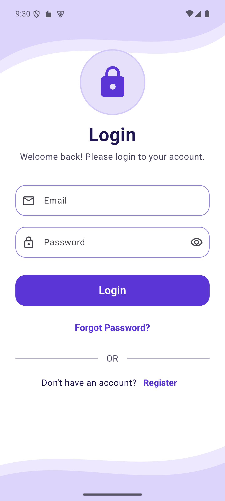
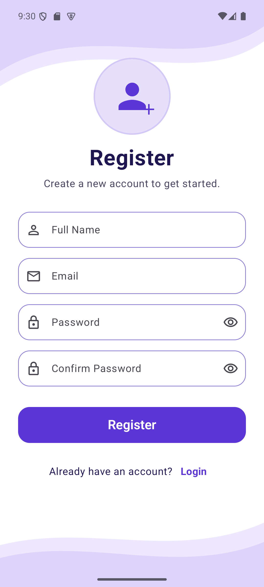

# Jetpack Compose Learning

Small practice projects for learning Jetpack Compose. Each folder is a separate
Android Studio project — open the folder itself in Android Studio to run it.

| Project | What it covers |
|---------|----------------|
| [LoginRegisterBasicTextFieldNoParams](LoginRegisterBasicTextFieldNoParams) | Login and Register screens with `OutlinedTextField`, password toggle, and screen switching without Composable parameters |
| [LoginRegisterWithBasicTextField](LoginRegisterWithBasicTextField) | Login, Register and Home screens with custom `BasicTextField` inputs, validation, and a `Canvas` wave background |

## LoginRegisterBasicTextFieldNoParams

A Login screen and a Register screen built with Jetpack Compose and Material 3.
[See the project details →](LoginRegisterBasicTextFieldNoParams)

| Login | Register |
|:-----:|:--------:|
|  |  |

## LoginRegisterWithBasicTextField

Login, Register and Home screens with custom text fields built from `BasicTextField`.
[See the project details →](LoginRegisterWithBasicTextField)

| Login | Register |
|:-----:|:--------:|
|  |  |
