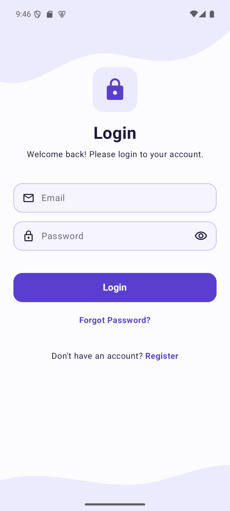
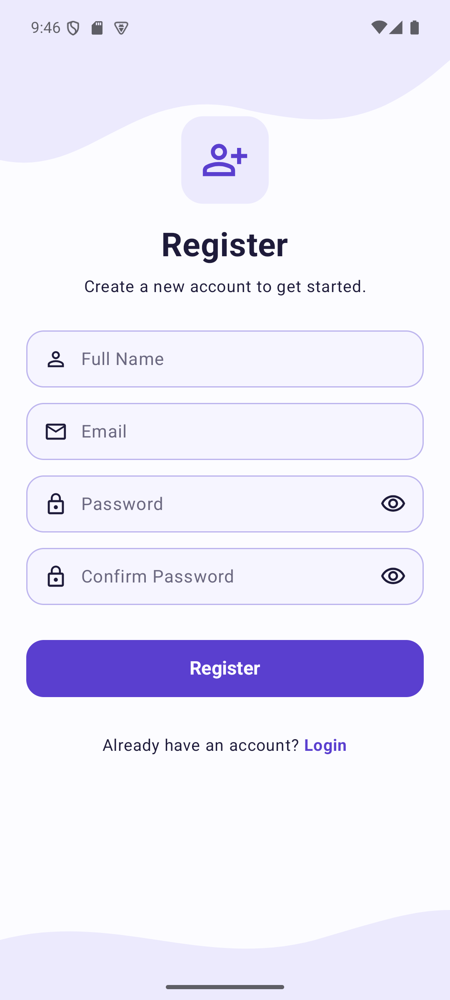

# Jetpack Compose Learning

Small practice projects for learning Jetpack Compose. Each folder is a separate
Android Studio project — open the folder itself in Android Studio to run it.

| Project | What it covers |
|---------|----------------|
| [LoginRegisterBasicTextFieldNoParams](LoginRegisterBasicTextFieldNoParams) | Login and Register screens with `OutlinedTextField`, password toggle, and screen switching without Composable parameters |
| [LoginRegisterWithBasicTextField](LoginRegisterWithBasicTextField) | Login, Register and Home screens with custom `BasicTextField` inputs, validation, and a `Canvas` wave background |
| [WeatherApp](WeatherApp) | Weather and 7-day forecast from the Open-Meteo API with Retrofit, `ViewModel`, `StateFlow`, loading / error / retry states, city search and pull-to-refresh |
| [ProductListingApp](ProductListingApp) | Product shop with `LazyVerticalGrid`, Navigation Compose with arguments, search / category filter / sort, Coil images, and a cart shared across screens |

## LoginRegisterBasicTextFieldNoParams

A Login screen and a Register screen built with Jetpack Compose and Material 3.
[See the project details →](LoginRegisterBasicTextFieldNoParams)

| Login | Register |
|:-----:|:--------:|
|  |  |

## LoginRegisterWithBasicTextField

Login, Register and Home screens with custom text fields built from `BasicTextField`.
[See the project details →](LoginRegisterWithBasicTextField)

| Login | Register |
|:-----:|:--------:|
|  |  |

## WeatherApp

Current weather and a 7-day forecast for any city, loaded from the free Open-Meteo API.
[See the project details →](WeatherApp)

| Weather | Search | Error |
|:-------:|:------:|:-----:|
|  |  |  |

## ProductListingApp

A product catalogue from the free Fake Store API, with a detail screen and a shared cart.
[See the project details →](ProductListingApp)

| Products | Sort | Detail | Cart |
|:--------:|:----:|:------:|:----:|
|  |  |  |  |
