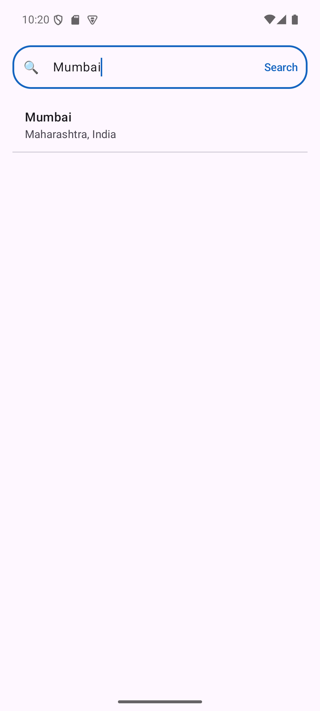
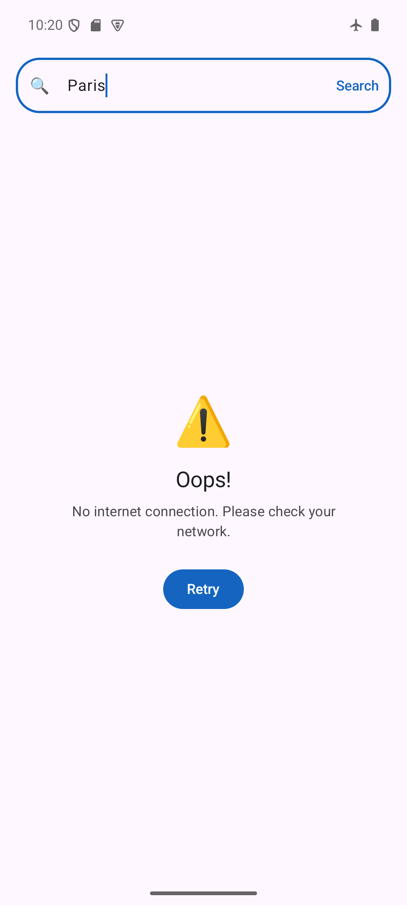

# Weather App

A simple weather app built with Jetpack Compose. It shows the current weather and a
7-day forecast for any city, using the free [Open-Meteo](https://open-meteo.com/) API
(no API key needed).

## Screenshots

| Weather | Search | Error |
|:-------:|:------:|:-----:|
|  |  |  |

## Features

- Current temperature, weather, feels like, humidity and wind
- 7-day forecast
- Search for any city and tap it to see its weather (starts with London)
- Loading, error and retry screens
- Pull down to refresh

## What you will learn

- **Retrofit** - calling a REST API with a `suspend` function
- **kotlinx.serialization** - turning JSON into Kotlin classes with `@Serializable` and `@SerialName`
- **Coroutines** - running network calls with `viewModelScope.launch`
- **ViewModel + StateFlow** - keeping screen data in a ViewModel and exposing it as `StateFlow`
- **UI states** - a `sealed interface` with `Loading`, `Success` and `Error`
- **collectAsStateWithLifecycle** - reading a `StateFlow` inside a Composable
- **LaunchedEffect** - showing a Snackbar when refresh fails
- **PullToRefreshBox** - Material 3 pull-to-refresh

## Open-Meteo API

The app uses two free Open-Meteo APIs. Neither needs an API key or an account.
Both are defined in `data/remote/OpenMeteoApi.kt` as Retrofit `suspend` functions.

### 1. Weather forecast - `getForecast()`

```
GET https://api.open-meteo.com/v1/forecast
```

| Parameter | Value used in the app | Meaning |
|-----------|-----------------------|---------|
| `latitude`, `longitude` | from the selected city | Where to get the weather for |
| `current` | `temperature_2m, apparent_temperature, relative_humidity_2m, wind_speed_10m, weather_code` | Values for right now |
| `daily` | `weather_code, temperature_2m_max, temperature_2m_min` | Values for each day (7 days) |
| `timezone` | `auto` | Use the city's own time zone for the days |

Example request (London):

```
https://api.open-meteo.com/v1/forecast?latitude=51.5085&longitude=-0.1257&current=temperature_2m,apparent_temperature,relative_humidity_2m,wind_speed_10m,weather_code&daily=weather_code,temperature_2m_max,temperature_2m_min&timezone=auto
```

Part of the response:

```json
{
  "current": {
    "temperature_2m": 9.5,
    "apparent_temperature": 8.2,
    "relative_humidity_2m": 88,
    "wind_speed_10m": 4.3,
    "weather_code": 3
  },
  "daily": {
    "time": ["2026-11-19", "2026-11-20", "..."],
    "weather_code": [61, 53, "..."],
    "temperature_2m_max": [10.1, 9.2, "..."],
    "temperature_2m_min": [6.0, 5.8, "..."]
  }
}
```

The JSON is read into `ForecastResponse` (in `data/remote/dto/`). `@SerialName` links the JSON
names to Kotlin names, for example `temperature_2m` → `temperature`.
The daily values come as separate lists: item 0 of each list is today, item 1 is tomorrow, and so on.

### 2. City search - `searchCity()`

```
GET https://geocoding-api.open-meteo.com/v1/search
```

| Parameter | Value used in the app | Meaning |
|-----------|-----------------------|---------|
| `name` | the text typed in the search field | City name to look for |
| `count` | `10` | Maximum number of results |

Example request: `https://geocoding-api.open-meteo.com/v1/search?name=Mumbai&count=10`

Part of the response:

```json
{
  "results": [
    {
      "name": "Mumbai",
      "latitude": 19.07283,
      "longitude": 72.88261,
      "country": "India",
      "admin1": "Maharashtra"
    }
  ]
}
```

The JSON is read into `GeocodingResponse`. If no city is found, `results` is missing from the JSON,
so it defaults to an empty list and the app shows "No city found".
The city's `latitude` and `longitude` are then used to call `getForecast()`.

The city search is on a different host than the forecast, so its `@GET` has the full URL.
A full URL in `@GET` replaces the base URL set in `RetrofitClient`.

### Weather codes

Open-Meteo sends the weather as a number (a WMO weather code). `model/WeatherCondition.kt`
turns it into text and an emoji:

| Code | Weather | Emoji |
|------|---------|:-----:|
| 0 | Clear sky | ☀️ |
| 1, 2, 3 | Mainly clear, partly cloudy, overcast | 🌤️ ⛅ ☁️ |
| 45, 48 | Fog | 🌫️ |
| 51, 53, 55 | Drizzle | 🌦️ |
| 56, 57, 61 - 67 | Freezing drizzle, rain, freezing rain | 🌧️ |
| 80, 81, 82 | Rain showers | 🌦️ |
| 71 - 77, 85, 86 | Snow | 🌨️ |
| 95 - 99 | Thunderstorm | ⛈️ |

Full API docs: [open-meteo.com/en/docs](https://open-meteo.com/en/docs) and
[open-meteo.com/en/docs/geocoding-api](https://open-meteo.com/en/docs/geocoding-api)

## How it works

1. `WeatherViewModel` starts loading the weather in `init`, so the screen shows `Loading`.
2. It asks `WeatherRepository`, which calls `OpenMeteoApi` through Retrofit.
3. The JSON is turned into DTO classes, and the repository changes them into simple models (`Weather`, `City`, ...).
4. The ViewModel sets the state to `Success(weather)`, or `Error(message)` if something went wrong.
5. `WeatherScreen` collects the state and shows the right UI. Pressing **Retry** calls `loadWeather()` again.

## How to run

1. Clone the repository:
   ```bash
   git clone https://github.com/himanshujha21/JetpackComposeLearning.git
   ```
2. In Android Studio, choose **File → Open** and select the `WeatherApp` folder (not the top-level folder).
3. Wait for Gradle sync to finish, then press **Run ▶** on an emulator or phone.
   The device needs an internet connection.

## Files

- `MainActivity.kt` - starts the app and shows `WeatherScreen`
- `data/remote/OpenMeteoApi.kt` - the Retrofit API: `getForecast()` and `searchCity()` (see [Open-Meteo API](#open-meteo-api))
- `data/remote/RetrofitClient.kt` - creates the Retrofit object
- `data/remote/dto/` - classes that match the JSON from the API
- `data/WeatherRepository.kt` - calls the API and converts the JSON classes into app models
- `model/` - `City`, `Weather`, `DailyForecast`, and the weather code → text / emoji functions
- `ui/WeatherViewModel.kt` - holds the screen state and handles loading, refresh and search
- `ui/WeatherUiState.kt` - `WeatherUiState` (Loading / Success / Error) and `SearchUiState`
- `ui/screens/WeatherScreen.kt` - the main screen
- `ui/components/` - `CitySearchBar`, `SearchResultsList`, `CurrentWeatherCard`, `DailyForecastRow`, `LoadingView`, `ErrorView`
