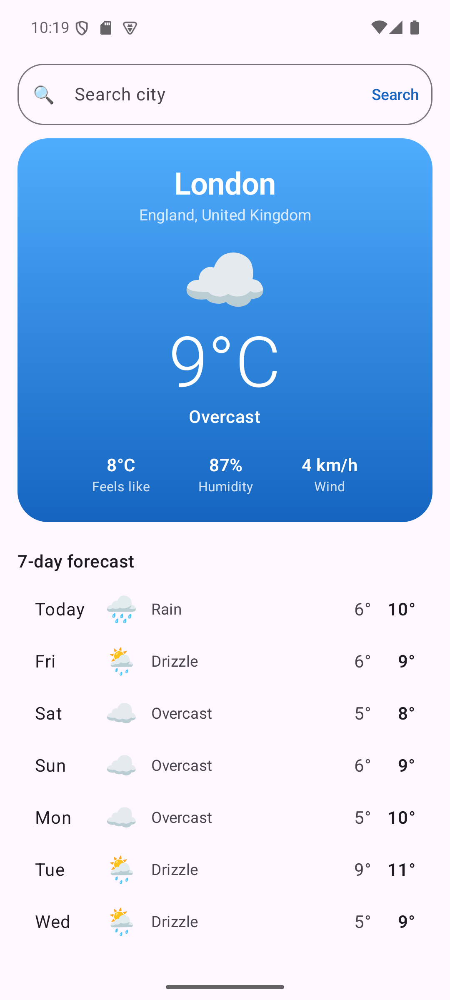

# Weather App

A simple weather app built with Jetpack Compose. It shows the current weather and a
7-day forecast for any city, using the free [Open-Meteo](https://open-meteo.com/) API
(no API key needed).

## Screenshots

| Weather | Search | Error |
|:-------:|:------:|:-----:|
|  |  |  |

## Features

- Current temperature, weather, feels like, humidity and wind
- 7-day forecast
- Search for any city and tap it to see its weather (starts with London)
- Loading, error and retry screens
- Pull down to refresh

## What you will learn

- **Retrofit** - calling a REST API with a `suspend` function
- **kotlinx.serialization** - turning JSON into Kotlin classes with `@Serializable` and `@SerialName`
- **Coroutines** - running network calls with `viewModelScope.launch`
- **ViewModel + StateFlow** - keeping screen data in a ViewModel and exposing it as `StateFlow`
- **UI states** - a `sealed interface` with `Loading`, `Success` and `Error`
- **collectAsStateWithLifecycle** - reading a `StateFlow` inside a Composable
- **LaunchedEffect** - showing a Snackbar when refresh fails
- **PullToRefreshBox** - Material 3 pull-to-refresh

## How it works

1. `WeatherViewModel` starts loading the weather in `init`, so the screen shows `Loading`.
2. It asks `WeatherRepository`, which calls `OpenMeteoApi` through Retrofit.
3. The JSON is turned into DTO classes, and the repository changes them into simple models (`Weather`, `City`, ...).
4. The ViewModel sets the state to `Success(weather)`, or `Error(message)` if something went wrong.
5. `WeatherScreen` collects the state and shows the right UI. Pressing **Retry** calls `loadWeather()` again.

## How to run

1. Clone the repository:
   ```bash
   git clone https://github.com/himanshujha21/JetpackComposeLearning.git
   ```
2. In Android Studio, choose **File → Open** and select the `WeatherApp` folder (not the top-level folder).
3. Wait for Gradle sync to finish, then press **Run ▶** on an emulator or phone.
   The device needs an internet connection.

## Files

- `MainActivity.kt` - starts the app and shows `WeatherScreen`
- `data/remote/OpenMeteoApi.kt` - the Retrofit API (forecast and city search)
- `data/remote/RetrofitClient.kt` - creates the Retrofit object
- `data/remote/dto/` - classes that match the JSON from the API
- `data/WeatherRepository.kt` - calls the API and converts the JSON classes into app models
- `model/` - `City`, `Weather`, `DailyForecast`, and the weather code → text / emoji functions
- `ui/WeatherViewModel.kt` - holds the screen state and handles loading, refresh and search
- `ui/WeatherUiState.kt` - `WeatherUiState` (Loading / Success / Error) and `SearchUiState`
- `ui/screens/WeatherScreen.kt` - the main screen
- `ui/components/` - `CitySearchBar`, `SearchResultsList`, `CurrentWeatherCard`, `DailyForecastRow`, `LoadingView`, `ErrorView`
